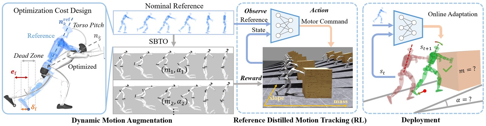

# PushMimic

**PushMimic: Learning Adaptive Humanoid Box Pushing via Dynamic Motion Augmentation and Reference Distillation**

[Yulun Zhuang](https://silvery107.github.io/), [Hanyu Zhang](https://www.linkedin.com/in/hanyu-zhang-33878b351/), [Jingyu Liu](https://juliusl-code.github.io/), [Yanran Ding](https://sites.google.com/view/yanranding/)

University of Michigan

[Project Page](https://arcad-lab-um.github.io/pushmimic/) | [Video](https://youtu.be/pdW_6NgSCAU) | Paper (coming soon)



## Overview

PushMimic lets a humanoid push a large box up a ramp without knowing the box mass or the ramp inclination.
It augments one level-ground human pushing motion into dynamically feasible references over a grid of masses and inclinations, and distills them into a single motion tracking policy that adapts its posture from interaction.

- 93.0% success over box masses from 5 to 15 kg and ramp inclinations from 0° to 18° in simulation (74.3% for the vanilla motion tracking baseline).
- 25% less thermal loss and 14% lower arm torque than the baseline.
- Sim-to-real transfer to a Unitree G1 pushing a 6 kg, 1 m tall box.

## Code

**Coming soon.** The code is being cleaned up and will be released in this repository.

Planned release:

- [ ] Augmented motion dataset
- [ ] Reference distilled motion tracking (policy training)
- [ ] Sim-to-sim deployment and pretrained policies

## Citation

If you find this work useful, please cite:

```bibtex
@article{zhuang2026pushmimic,
  author  = {Yulun Zhuang and Hanyu Zhang and Jingyu Liu and Yanran Ding},
  title   = {PushMimic: Learning Adaptive Humanoid Box Pushing via Dynamic Motion Augmentation and Reference Distillation},
  journal = {arXiv preprint arXiv:TODO},
  year    = {2026},
}
```

## License

This project is released under the [MIT License](LICENSE).
